# Lab 1: Office Network with VLANs, Routing, DHCP, NAT and Access List

I built a small office network in Cisco Packet Tracer, a free network simulator. It has three separate networks: Staff, Guest, and Servers. Guests can use the internet, but they cannot reach the staff devices or the server.

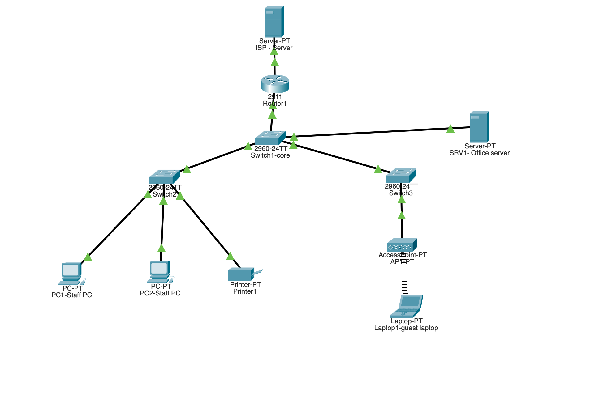

## What I used

- 1 router, 3 switches, 2 PCs, 1 printer, 1 office server
- 1 access point and 1 laptop for guest Wi-Fi
- 1 server that stands in for the internet (ISP-Server)

## The three networks

A VLAN is a way to split one switch into separate networks. Devices in different VLANs cannot see each other unless a router connects them.

| VLAN | Name | Network | Gateway |
|---|---|---|---|
| 10 | Staff | 192.168.1.0/26 | 192.168.1.1 |
| 20 | Guest | 192.168.1.64/26 | 192.168.1.65 |
| 30 | Servers | 192.168.1.128/26 | 192.168.1.129 |

The gateway is the router's address in each network. Devices send traffic there when they want to reach another network.

## What I did with VLANs

A VLAN splits one switch into separate networks. In this lab I made three VLANs and used them to keep Staff, Guests, and the server apart.

**1. I made the same three VLANs on all three switches**

| VLAN | Name |
|---|---|
| 10 | Staff |
| 20 | Guest |
| 30 | Servers |

**2. I put each port in the right VLAN**

| Switch | Port | Connected to | VLAN |
|---|---|---|---|
| SW2 | Fa0/1 | PC1 | 10 Staff |
| SW2 | Fa0/2 | PC2 | 10 Staff |
| SW2 | Fa0/3 | Printer1 | 10 Staff |
| SW3 | Fa0/1 | Access point (guest Wi-Fi) | 20 Guest |
| SW1 | Fa0/10 | Office server | 30 Servers |

**3. I made trunk links**

A trunk carries all the VLANs on one cable. I made three: SW1 to SW2, SW1 to SW3, and SW1 to the router.

**4. I gave the router one virtual port for each VLAN**

This is how the VLANs talk to each other. Each virtual port is the gateway for its VLAN.

**5. I checked it with `show vlan brief` and `show interfaces trunk`**

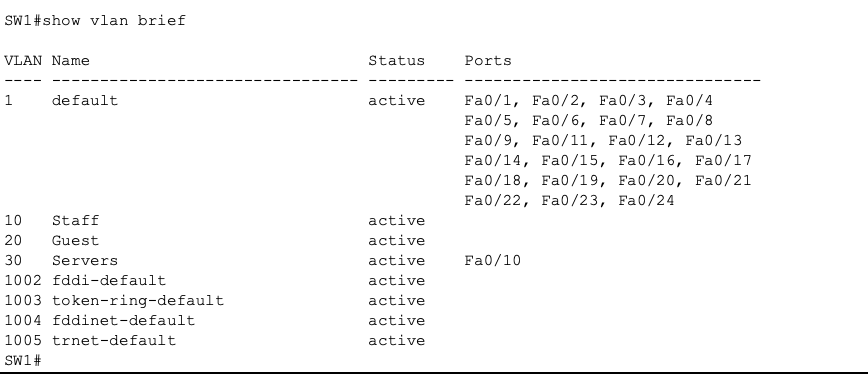
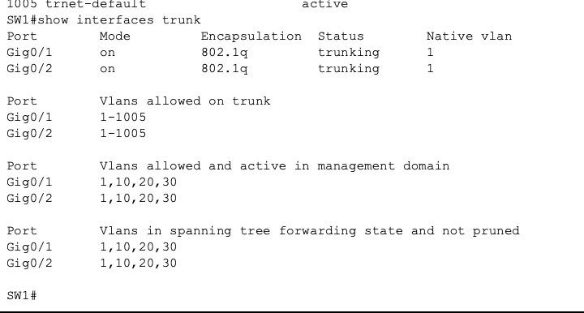
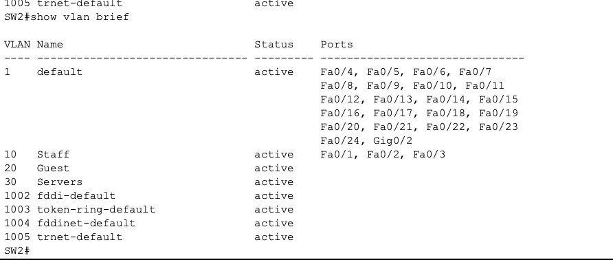
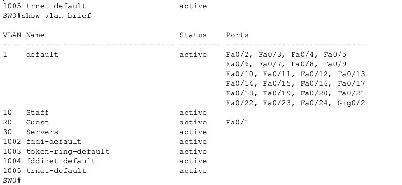

## What I did, step by step

1. **Connected the devices.** I placed the devices and connected them with cables.
2. **Made the VLANs.** I created VLANs 10, 20, and 30 on the three switches and put each port in the right VLAN. The links between the switches are trunks. A trunk carries all the VLANs on one cable.
   
   
3. **Set up the router.** The router has one virtual port for each VLAN. This lets the networks talk to each other.
   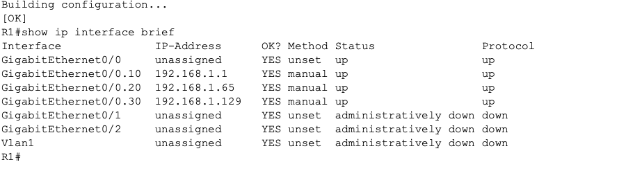
4. **Turned on DHCP.** DHCP gives IP addresses to devices automatically. The staff PCs and the guest laptop get their addresses from the router. The server and the printer use fixed addresses.
   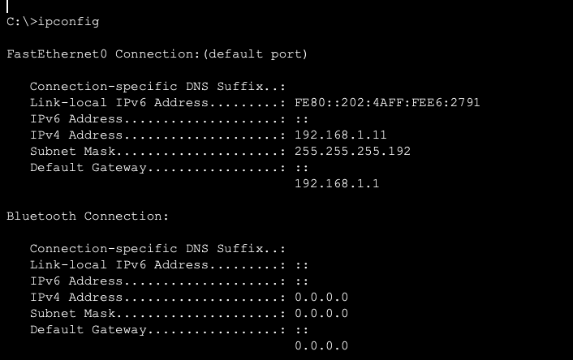
5. **Tested routing between VLANs.** PC1 in Staff can reach the server in Servers.
   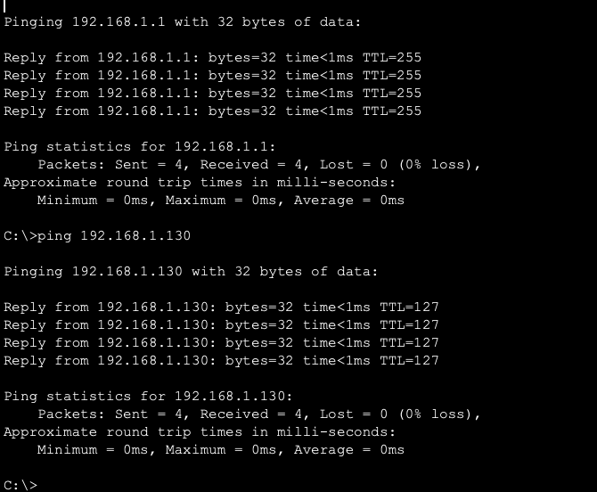
6. **Added NAT.** NAT changes the private office addresses into one public address when traffic goes out to the internet.
   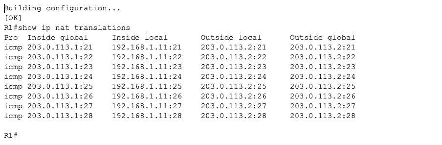
7. **Added Wi-Fi for guests.** The laptop connects to the access point and gets an address in the Guest network.
   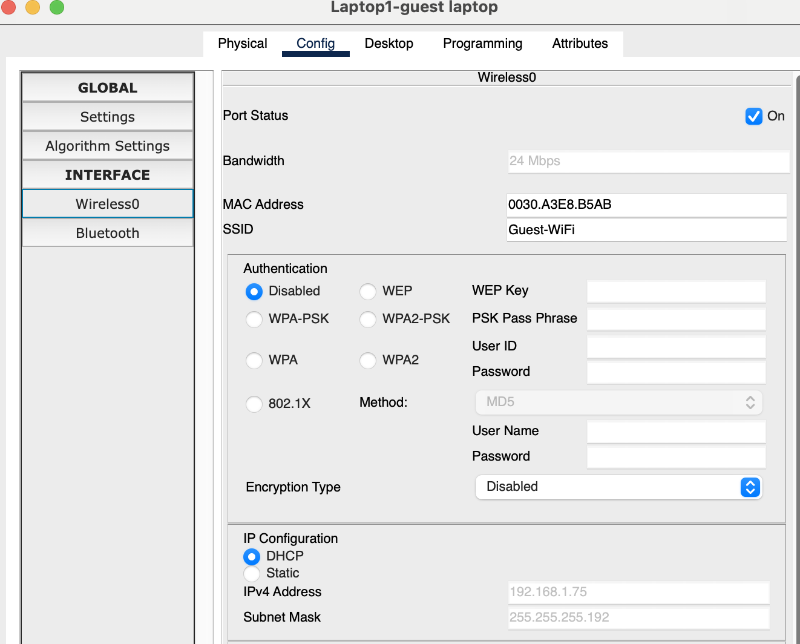
   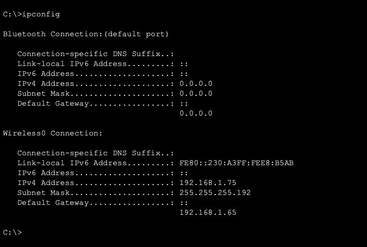
8. **Blocked guests from the office.** An access list is a list of rules on the router. Mine stops the Guest network from reaching Staff and the server, and still allows the internet.
   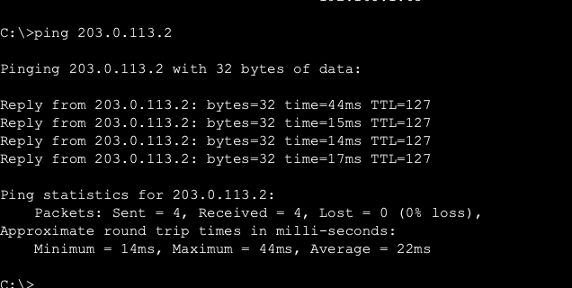
   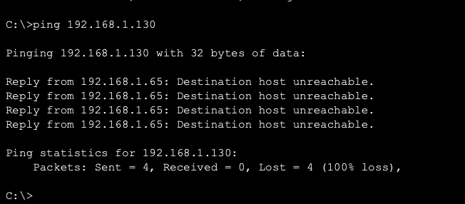
   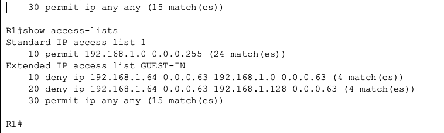

## Results

- A staff PC can reach the server in another VLAN. The reply came back with TTL 127, which shows the traffic went through the router.
- NAT works. The router shows the private address 192.168.1.11 being changed to 203.0.113.1.
- The access list works. The rules that block guests from Staff and from the server each counted 4 blocked packets.

## Files

- `office-network.pkt` is the Packet Tracer file. You can open it and look around.
- `configs/` has the commands for each device.
- `screenshots/` has the pictures used above.

## Notes

- This was built in a simulator, not on real equipment.
- The guest Wi-Fi has no password. A real guest network would have one.
- `R1.txt` is the router's saved configuration. The switch files (`SW1.txt`, `SW2.txt`, `SW3.txt`) hold the commands I typed on each switch.
- ISP-Server stands in for the internet. It is not a real website.

## What I learned

- Separate networks make the office easier to protect.
- The router needs one virtual port for each VLAN to connect them.
- The counters on an access list show which rules caught traffic.
