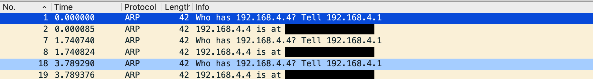
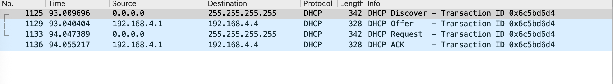
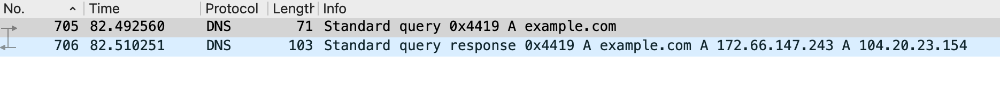
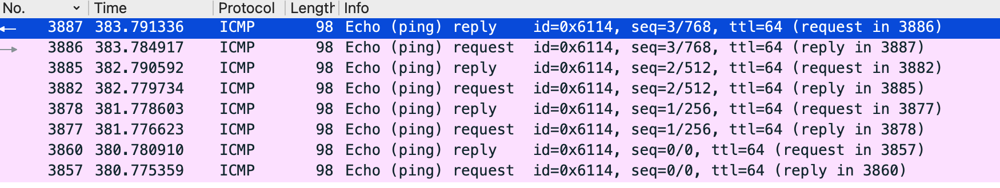
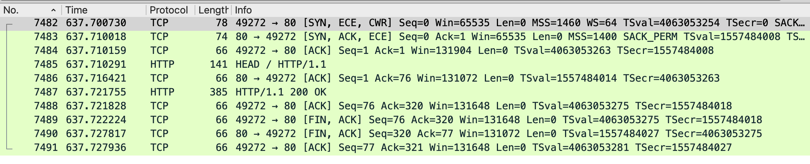

# Lab 3: See the Traffic (Wireshark)

## What I did
In Labs 1 and 2 I built and fixed networks. In this lab I wanted to see what really happens on the wire. I used Wireshark on my own Mac and Wi-Fi and looked at five things: ARP, DHCP, DNS, ping and the TCP handshake.

I only captured traffic on my own network. I covered my MAC address in the screenshots.

## Tools
- Wireshark 4.6.9 on macOS
- Terminal (nslookup, ping, curl)

## 1. ARP: who has this IP?
My Mac asks "Who has 192.168.4.4? Tell 192.168.4.1". The device answers "192.168.4.4 is at (its MAC address)". This is how a device finds the MAC address that belongs to an IP address.

Filter: `arp`

## 2. DHCP: getting an IP address
A device gets its address in 4 steps: Discover, Offer, Request, ACK (DORA).

Filter: `dhcp`

## 3. DNS: name to IP
I ran `nslookup example.com`. My Mac sent a query ("what is the IP of example.com?") and got an answer with the IP addresses.

Filter: `dns.qry.name == "example.com"`

## 4. Ping (ICMP)
I ran `ping -c 4 192.168.4.1`. Wireshark shows 4 echo requests and 4 echo replies (seq 0 to 3).

Filter: `icmp && frame.len == 98`

## 5. TCP handshake
I ran `curl -I http://example.com`. The connection starts with SYN, SYN-ACK, ACK. Then the web request (HEAD) and the answer (200 OK). At the end, both sides close with FIN, ACK.

Filter: `tcp.port == 49272` (my Mac's port for this connection)

## What I learned
- ARP connects an IP address to a MAC address on the local network.
- DHCP gives a device its IP address in 4 steps.
- DNS turns a name into an IP address.
- Ping uses ICMP to check if a device answers.
- TCP always starts with a 3-step handshake.
- Display filters make it easy to find one thing in a lot of traffic.
