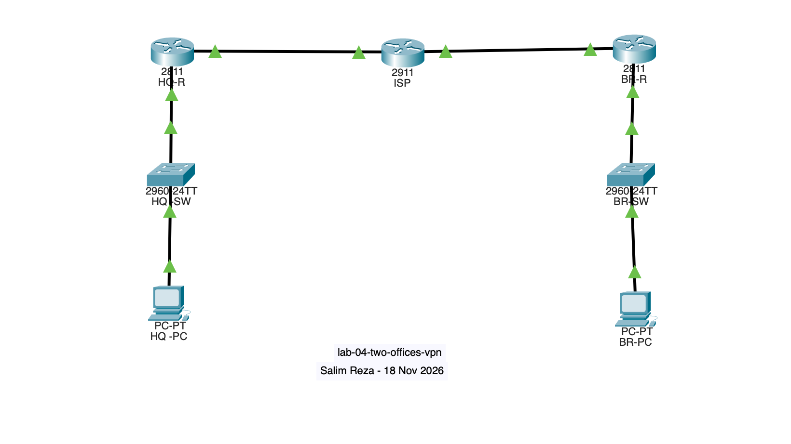
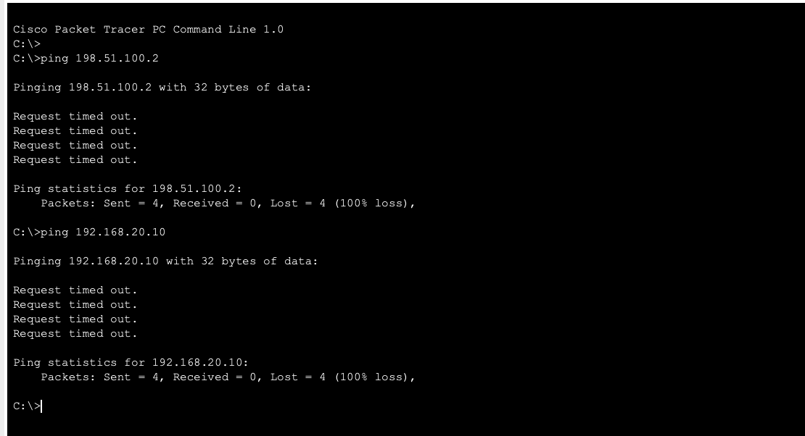
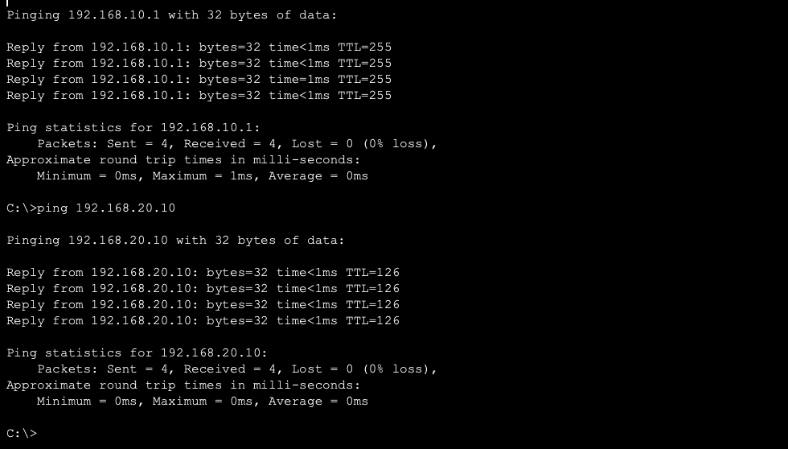
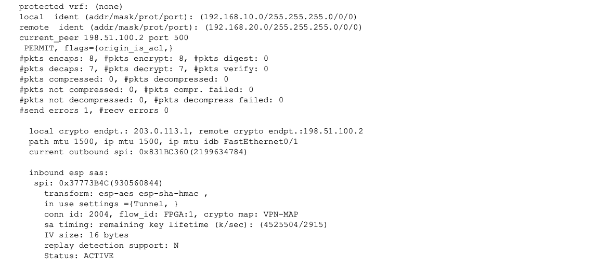

# Lab 4: Two Offices Joined by a **VPN**

## What I did
I built two small offices, Berlin (HQ) and Hamburg (Branch), and joined them with an encrypted **VPN** tunnel (IPsec site-to-site). A router in the middle plays the Internet. It does not know the private office networks, so without the VPN the two offices cannot talk to each other.

My name and the date are on the topology picture.

## Tools
- Cisco Packet Tracer 9.0.1

## The network

| Device | Model | Role |
|---|---|---|
| HQ-R-Salim | Router 2811 | HQ router, VPN end |
| ISP-Salim | Router 2911 | Plays the Internet |
| BR-R-Salim | Router 2811 | Branch router, VPN end |
| HQ-SW, BR-SW | Switch 2960 | Office switches |
| HQ-PC, BR-PC | PC | Test computers |

| Network | Address |
|---|---|
| HQ office | 192.168.10.0/24 (PC 192.168.10.10, router 192.168.10.1) |
| Branch office | 192.168.20.0/24 (PC 192.168.20.10, router 192.168.20.1) |
| HQ to ISP | 203.0.113.0/30 (HQ .1, ISP .2) |
| Branch to ISP | 198.51.100.0/30 (ISP .1, Branch .2) |

Each office router has a default route to the ISP router.

## Step 1: Before the VPN
I pinged from HQ-PC to the Branch router and to BR-PC. Both failed. The ISP router has no route back to private addresses, so this is what I expected.

## Step 2: Build the VPN
On both office routers I set up the same things (the two sides mirror each other):
1. **ISAKMP policy**: how the two routers agree on keys (AES, SHA, pre-shared key, group 2).
2. **Pre-shared key**: the password both routers know. It is a lab password, and I left it out of the config files.
3. **Transform set**: how the data is protected (ESP with AES and SHA).
4. **Access list 110**: which traffic goes into the tunnel. Only HQ to Branch and Branch to HQ.
5. **Crypto map**: puts it all together and points to the other router.
6. The crypto map is set on the Internet port (Fa0/1).

The full settings are in the `configs` folder.

## Step 3: After the VPN
HQ-PC can now ping BR-PC. The TTL is 126, so the packets went through both routers.

## Step 4: Proof that it is encrypted
`show crypto ipsec sa` shows packets that were encrypted (encaps) and decrypted (decaps), with the tunnel set to ACTIVE.

## Problems I had
- **No crypto commands on the 2911.** The `crypto isakmp` command gave "Invalid input". The security license would not turn on in my Packet Tracer version, even after a reload. I tested a 2811 router and the VPN commands worked there, so I used 2811 routers for the two offices.
- **Ping failed after swapping the routers.** The PC still remembered the old router's MAC address. I cleared it with `arp -d` and then it worked.
- **The router setup wizard.** A new router asks if I want the initial configuration dialog. I have to answer `no` first, or it takes my commands as answers.

## What I learned
- A VPN tunnel only protects the traffic I choose with the access list.
- Both sides must match: same policy, same key, mirrored access lists.
- Private addresses cannot cross the Internet, but a VPN carries them inside an encrypted tunnel.
- A device can keep an old ARP entry after a router is replaced.
