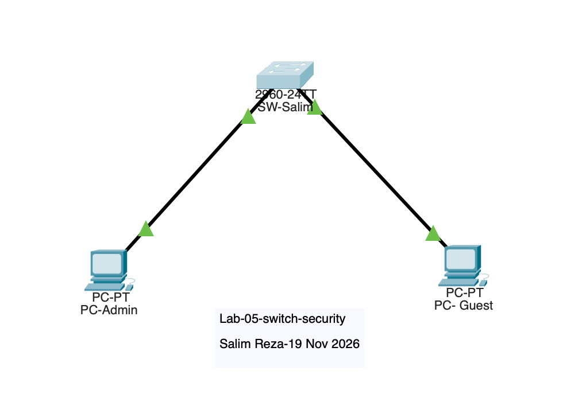
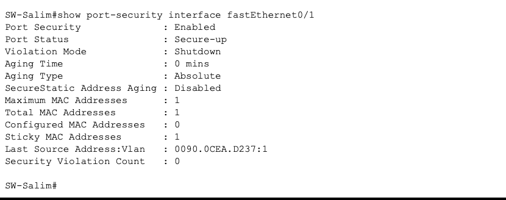
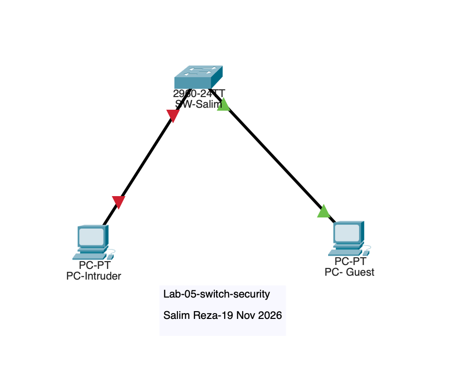
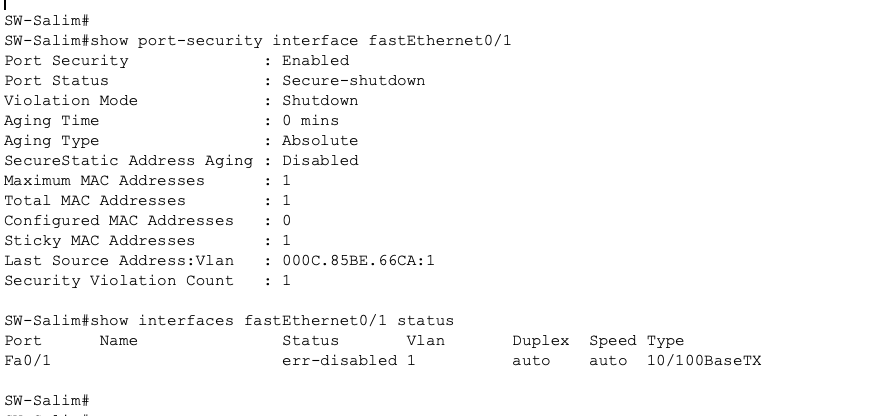
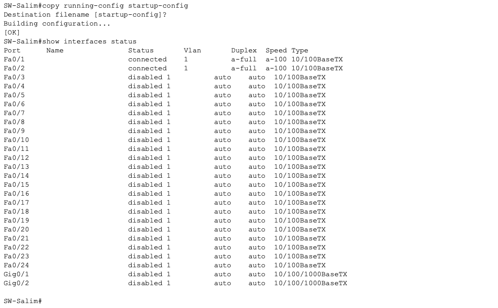

# Lab 5: Switch Security

## What I did
I took a small office switch and made it safer in three ways:
1. **SSH** instead of Telnet, so the login to the switch is encrypted.
2. **Port security**, so a port only accepts the computer it learned first.
3. **Unused ports shut down**, so nobody can plug in a cable and get access.

My name and the date are on the topology picture.

## Tools
- Cisco Packet Tracer 9.0.1

## The network
One switch (SW-Salim, 192.168.1.2) and two computers.

| Device | Address | Switch port |
|---|---|---|
| PC-Admin | 192.168.1.10 | Fa0/1 |
| PC-Guest | 192.168.1.20 | Fa0/2 |

## Step 1: Before
With no protection, the two computers can talk to each other, and anyone who plugs in a cable would get a port.

## Step 2: SSH
I gave the switch an address on VLAN 1, a user name and password, and turned on SSH version 2. Then I only allowed SSH on the login lines (`transport input ssh`). From PC-Admin the SSH login works. Telnet connects and is closed right away, with no login prompt.

## Step 3: Port security
On Fa0/1 and Fa0/2 I turned on port security. Each port allows 1 MAC address, learns it by itself ("sticky"), and shuts down if another computer shows up (violation mode shutdown).

## Step 4: The intruder test
I unplugged PC-Admin and plugged in a new computer, PC-Intruder, on Fa0/1. The switch saw a new MAC address and shut the port down. The port went to `err-disabled`, the violation count went to 1, and the link turned red. The guest port kept working.

After the test I removed the intruder, plugged PC-Admin back in, and turned the port back on with `shutdown` and then `no shutdown`. PC-Admin worked again.

## Step 5: Shut the unused ports
I shut down Fa0/3 to Fa0/24 and both Gigabit ports. Only the two ports in use stay connected.

The full settings are in `configs/SW-Salim.txt`. I left the passwords out of the file.

## What I learned
- Telnet sends everything as plain text. SSH is encrypted, so I should always use SSH.
- Port security ties a port to a MAC address. A new device on the port shuts it down.
- A port in `err-disabled` stays down until an admin turns it off and on again.
- Shutting unused ports is a simple step that closes an easy way in.
